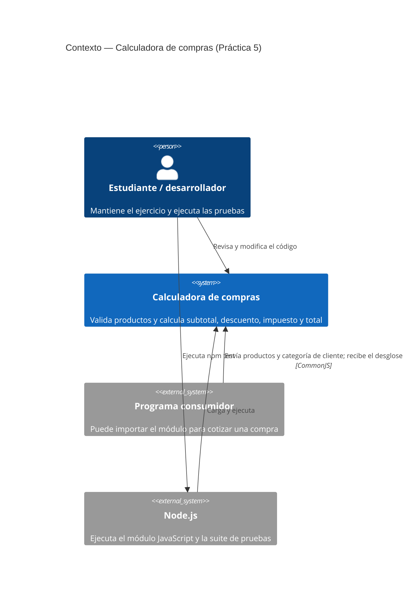
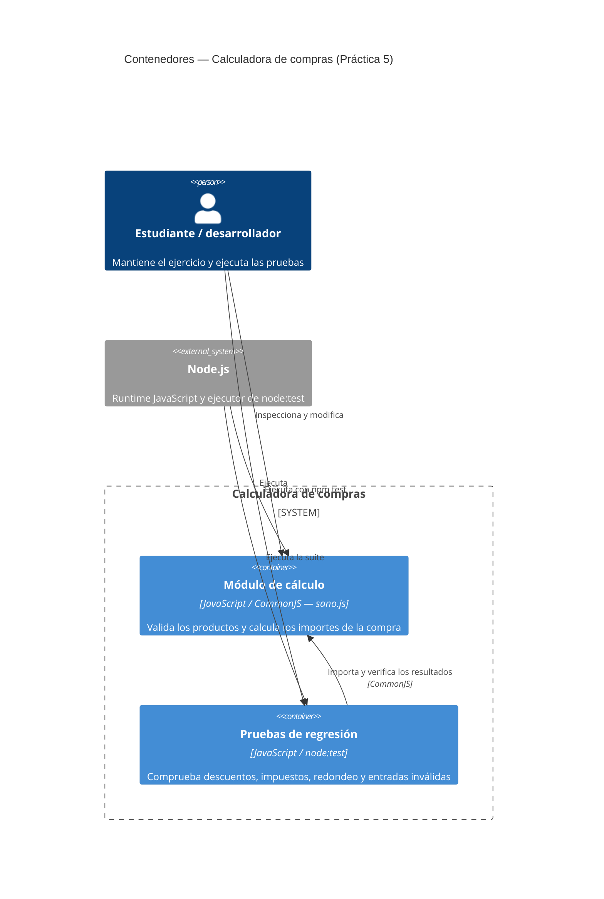

# Práctica 6: Arquitectura C4 de la calculadora de compras

**Token de propiedad:** `LEARN-CAP-AAf98C6D`

## Alcance del modelo

El repositorio contiene prácticas independientes, no una aplicación única de
Claros Auto ni un backend compartido. Para modelar un sistema real que ya está
implementado aquí, esta práctica toma la **calculadora de compras de
`practica-5`**: su versión corregida está en `sano.js`, y las pruebas de
regresión están en `tests/clinica.test.js`. `enfermo.js` representa el estado
defectuoso que se diagnostica; no forma parte del flujo sano.

La calculadora recibe productos (precio y cantidad) y una categoría de cliente.
Devuelve subtotal, descuento, impuesto y total. No conserva datos entre
llamadas ni depende de una base de datos o de una red.

## Nivel 1: contexto del sistema

### Justificación del contexto

- El estudiante es el actor que mantiene el código y verifica sus cambios.
- Un programa consumidor representa el límite de integración del módulo: le
  entrega datos y recibe un resultado; no se asume una interfaz web inexistente.
- Node.js es una dependencia externa de ejecución. El repo declara
  `node --test` como comando para las pruebas.
- El sistema es intencionalmente local y sin estado: cada cálculo depende solo
  de los argumentos de esa llamada.

## Nivel 2: contenedores

### Justificación de los contenedores

- **Módulo de cálculo:** `sano.js` es una biblioteca CommonJS que concentra la
  lógica de dominio. Separa validación, redondeo y cálculo en funciones con
  responsabilidades claras.
- **Pruebas de regresión:** `tests/clinica.test.js` valida el comportamiento
  esperado desde fuera del módulo. Usa `node:test` y no requiere servicios
  adicionales.
- **Ejecución:** Node.js ejecuta ambos contenedores en el entorno local. El
  archivo `package.json` ofrece `npm test` como punto de entrada.
- No se modelan base de datos, API, interfaz gráfica ni servicios externos
  porque el código existente no los implementa. Agregarlos al diagrama
  describiría un sistema distinto al del repositorio.

## Flujo de cálculo

1. El consumidor pasa productos y la categoría del cliente al módulo.
2. El módulo rechaza listas vacías, precios inválidos y cantidades que no sean
   enteros positivos.
3. Calcula el subtotal; aplica 10 % de descuento solo a clientes premium con
   subtotal de al menos 1,000; calcula 15 % de impuesto sobre el subtotal
   después del descuento.
4. Devuelve los cuatro importes redondeados a dos decimales.
5. La suite comprueba los casos de negocio y los errores de validación.
